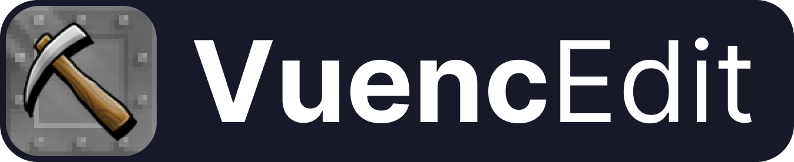
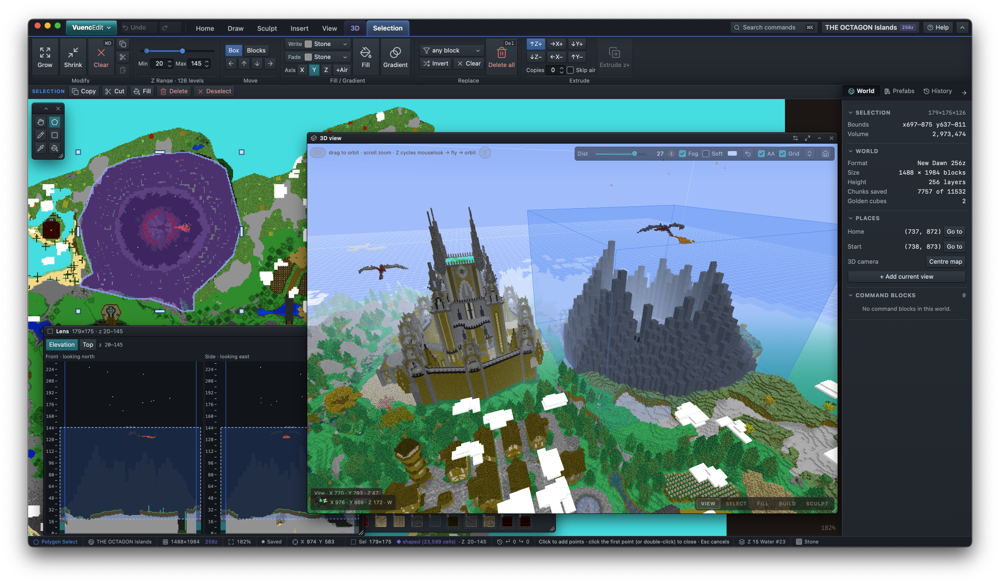

<p align="center">
  
</p>

# VuencEdit

**[Website & support](https://hagg3.github.io/VuencEdit/)**

VuencEdit is a full-scale world editor for **[Eden: World Builder](https://store.steampowered.com/app/5004190/Eden__World_Builder/)** and **[Eden: Community Edition](https://github.com/hagg3/edencom)** world files. It is written in Rust and is a small, lightweight, cross-platform Tauri program.

Eden World Builder was created by Ari Ronen.
<p align="center">
  
</p>
This community-developed project is the successor to Eden World Manipulator, which was itself based on Vuenctools, created after the game's file format was reverse engineered by Robert Munafo before the Eden 2.1 source code was released in 2018. 

As well as adding support for the latest world formats (as of updates in 2026 adding signs, and new block types), this program offers near-parity with editors like Axiom for Minecraft and includes brand-new features such as:

- Prefab importing/exporting across worlds.
- 3D viewport allowing you to fly through, edit, and make selections within your world.
- Instant pan-zoom across the default top-down 2D map view.
- Axiom-style 3D sculpt tools for creating natural looking terrain.
- All features from World Manipulator ported to rust (such as tree generation), and improved.
- Full integration with the shared world service for both the latest and legacy versions of the game.

Questions, bug reports and screenshots of cool builds are all welcome on the game's
[Discord server](http://discord.gg/rjYXwBC).

## Download

Installers for macOS (universal), Windows and Linux are on the [Releases](../../releases) page.

Please note that the macOS app is not notarized, which means you may get an error like "VuencEdit can't be opened because Apple cannot check it for malicious software" or "VuencEdit is damaged and can't be opened." To open the program, use one of the methods below. You only need to do this once.

macOS 15 Sequoia and later (Open Anyway):
1. Drag VuencEdit into your Applications folder.
2. Double-click it. When the warning appears, click Done (not "Move to Trash").
3. Open System Settings → Privacy & Security.
4. Scroll down to the Security section. You'll see "VuencEdit was blocked to protect your Mac." Click Open Anyway.

macOS 14 Sonoma and earlier (right-click → Open):
1. Drag VuencEdit into your Applications folder.
2. Right-click (or Control-click) the app and choose Open.
3. In the dialog, click Open.

## What you can do with it

**Look around in 2D.** You can easily zoom and pan a top-down 2D map of your world. There are options for z-slice or cutaway so you can see below the surface, and a relief mode to see where the terrain rises and falls.

**Look around in 3D.** There is a floating window that gives you access to a true 3D-editor style viewport that will let you render the map live in 3D, with textures, optional shaders and a much higher render distance than normal. You can also edit directly in this 3D view.

**Select and edit.** You can use a range of tools for making regular and irregular selections. There are also drawing tools for the 2D map.

**Sculpt terrain**. Axiom-style sculpt tools allow you to build realistic and varied terrain quickly.

**Copy, paste and prefabs.** You can copy and paste your selections, with options to rotate/flip before you paste. You can also save copied selections as prefabs to use again later in any world.

**Generate worlds.** You can create new worlds with a variety of options for specifiying dimensions, or whether you want terrain. A range of terrain options are included (classic, new or custom terrain).

**Shared worlds.** There is a shared worlds browser, so you can upload and download worlds to and from the same in-game list that you are used to.

Most features live on the ribbon. 

Most of this lives on the ribbon (Home, Selection, Clipboard, Draw, Sculpt, Insert, View and 3D). If you can't find something, press **⌘K** (**Ctrl+K**) and type what you're
after.

## Something went wrong?

If it's slow, crashes or draws something odd (especially in the 3D view), open
**Help ▸ Diagnostics…**, click **Refresh**, then **Copy to clipboard** or **Save as .txt…**. Post
that along with what you were doing on [Discord](http://discord.gg/rjYXwBC) or in a GitHub issue.
The report covers memory use, your GPU, and loading/frame timings. It doesn't include your folders or world contents, and nothing is sent anywhere unless you post it yourself. If the problem is in 3D,
turning on **Settings ▸ 3D performance HUD** before you reproduce it adds a live readout to the pane.

## Building it yourself

You'll need [Rust](https://rustup.rs) (stable; `rust-toolchain.toml` selects it) and
[Node.js](https://nodejs.org) 20.19 or newer (22 recommended; `.nvmrc` pins it). Then install the
[Tauri prerequisites](https://v2.tauri.app/start/prerequisites/) for your platform: Xcode Command
Line Tools on macOS, MSVC Build Tools + WebView2 on Windows. On Linux that's:

```bash
sudo apt-get install build-essential pkg-config libssl-dev libwebkit2gtk-4.1-dev \
  libappindicator3-dev librsvg2-dev patchelf
```

Then, from the repo root:

```bash
npm ci
npm run tauri dev     # run with hot reload
npm run tauri build   # installers end up in target/release/bundle/
npm run check         # type-check, lint and tests (frontend and Rust)
```

Pushing a `v*` tag builds all three platforms on GitHub Actions and publishes a draft release.

## How it works

VuencEdit is a [Tauri 2](https://tauri.app) app, with a Rust backend and a React/TypeScript
frontend. The map is drawn on an HTML canvas and the 3D view uses Three.js.

The Rust side does all the heavy work. It parses the world, renders map tiles, meshes 3D chunks,
generates terrain, and applies edits and undo. Eden worlds can run to several gigabytes, so
nothing loads the whole file into memory. VuencEdit works on a private copy of the world, maps it
from disk, and only reads the chunks it needs. Image and mesh data reach the frontend as raw binary
rather than JSON. Undo stores compressed per-chunk differences under a memory budget you can set in
Settings. The pure voxel code (colours, rendering, meshing, lighting) lives in a separate
`voxel-core` crate, which Eden's multiplayer companion app VuencLink also uses.

The long version (file format, rendering, editing and undo, and a reference for every backend
command) is in the developer docs at `docs/docs/dev/`, also published on the project's docs site.

## Licence

VuencEdit is free software. It ports parts of Eden: World Builder's source code, which Ari Ronen
released in 2018 under the GNU GPL v3, so VuencEdit as a whole is distributed under the
[GPL v3](COPYING). VuencEdit's own files, which is most of them, can also be used on their own under the
[MIT licence](LICENSE). The files that port Eden's code are GPL-only, and
[`NOTICE.md`](NOTICE.md) lists them.

The bundled Eden textures and app icon are © Ari Ronen / Kingly Games and are not covered by
either licence. VuencEdit is a fan project, not affiliated with or endorsed by Kingly Games.
